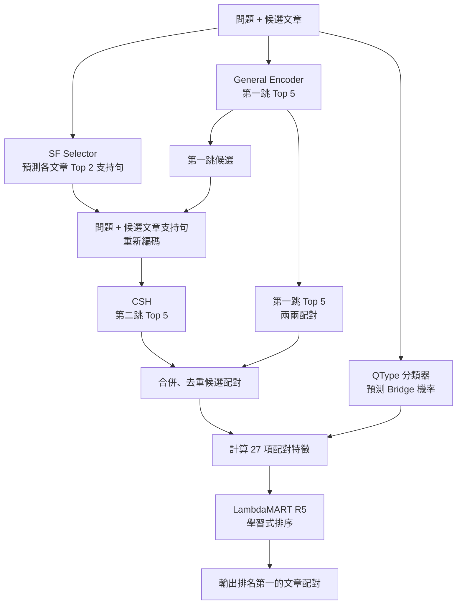
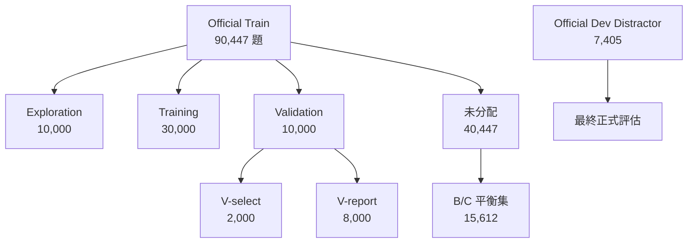

# HotpotQA 多跳檢索研究：從找文章到找對文章配對

> **研究重點**：如何在 HotpotQA Distractor 提供的候選文章中，找出回答問題所需的**兩篇支持文章**？
>
> **評估指標**：Pair Recall@1（PR@1），即系統排名第一的文章配對是否同時包含兩篇正確文章，**不等於答案生成正確率**。

## 01｜研究問題

一般檢索只需要找到一篇相關文章；**多跳檢索必須找到彼此有關聯的兩篇文章**。本研究使用 HotpotQA Distractor：每題提供 2–10 篇候選文章，其中有兩篇正確支持文章，配對不區分先後順序。

資料即主要分為兩種題型，且比例不均。
- **Bridge（橋接）**：需要從一篇文章取得線索，再找另一篇。
- **Comparison（比較）**：需要取得兩個對象的資料，才能完成比較。

研究一開始的關鍵觀察：**找到一篇正確文章很容易，找齊兩篇卻困難。**

| 初期單跳檢索（10,000 題） | 第一名找到任一正確文章 | 前兩名找齊兩篇 |
|:--|--:|--:|
| BM25 Local | 83.20% | 34.26% |
| Frozen Dense | 83.15% | 33.33% |
| Hybrid Local | **86.03%** | **37.82%** |

這說明不能只優化「第一篇文章是否相關」，而要直接處理**完整文章配對**。

## 02｜研究演進

### 第一階段：先檢查第二跳是否真的有效（O／E 系列）

我們先固定已知正確的第一篇文章，檢查能否找到另一篇，避免把第一跳錯誤和第二跳能力混在一起。

| 第二跳實驗 | 做法 | 結果 |
|:--|:--|--:|
| 已知正確文章 A | 問題 + A 全文 → 找 B | A→B **55.13%**；B→A **55.64%** |
| 已知 A 的正確支持句（Oracle） | 問題 + A 的正確證據句 → 找 B | 約 **62%** |
| 自主選起點（P3） | 模型先找前三篇，再建立配對 | PR@1 **33.24%** |

**發現**：即使給了正確起點，第二跳也只有約 55% 成功率；證據句比整篇文章更有用。但 Oracle 使用真實支持句，**只能作研究診斷，不能直接部署**。

方向也值得注意：以文章原始順序定義 A/B 時，兩方向平均差距不大；但在模型第一名已找到正確文章的 8,315 題中，從「模型較容易找到的那篇」出發，第二跳成功率只有 **44.57%**，反方向為 **75.71%**。這提示**第一跳最容易找到的文章，未必是最好的推理起點**；目前仍不能把這個現象解釋為已證實的單一原因。

### 第二階段：增加候選，為何沒有改善結果？（R 系列）

我們調整第一跳搜尋寬度（Beam），發現正確配對更容易進入候選集，但最後的排名反而下降。

| 第一跳寬度 | 正確配對出現在候選中 | 最終 PR@1 |
|:--|--:|--:|
| Top 1 | 70.08% | **37.06%** |
| Top 3 | 80.91% | 33.24% |
| Top 5 | 84.46% | 32.98% |
| 全部 | **98.37%** | 32.70% |

在 Top 3 的失敗案例中，約 **71.4%** 其實已包含正確配對，只是**排序排錯**。

**研究轉折**：瓶頸不只是「找不到候選」，更是「找到了卻選不對」。因此從單純增加檢索寬度，轉向**專用檢索器 + 學習式配對排序**。

### 第三階段：改良檢索模型，提升多跳檢索能力

前面的實驗發現，第二跳檢索能力不足，而增加候選數量又無法解決排序問題。因此，我們從**文章資訊處理、專用模型訓練與題型辨識**三個方向改善。

**1. 文章資訊處理：從全文轉向關鍵證據**

為避免長文章因長度限制而遺失重要資訊，我們比較三種內容處理策略：

- **Chunk Mean**：將文章分塊，以各區塊的平均相似度評分。
- **Chunk Max**：將文章分塊，以最高區塊相似度評分。
- **依問題選句**：根據問題挑選相關句子，減少無關資訊。

本階段測試的分塊與問題導向選句策略，均未穩定優於原始截斷設定，部分分塊方法還提高了干擾文章的分數。因此，我們改為訓練模型辨識真正有用的支持句（Supporting Facts，SF）。

**2. 專用模型：改善第一跳與第二跳**

本研究以 **`sentence-transformers/all-MiniLM-L6-v2`** 作為主要預訓練模型，採用 6 層 Transformer、384 維向量，並以 Cosine Similarity 進行語意檢索。General 與 CSH 使用相同基礎架構，但分別進行 Fine-tuning，最終使用不同的模型權重。

| 模組 | 解決的問題 | 採用方法 |
|:--|:--|:--|
| **General Encoder** | 通用向量模型難以區分相似但錯誤的文章 | 使用 Hard Negatives（困難負例）微調，負責第一跳檢索 |
| **SF Selector** | 第一篇文章全文包含過多無關資訊 | 預測每篇文章最相關的 Top 2 支持句 |
| **Conditional Second-Hop（CSH）** | 第二跳需要利用第一篇文章的資訊 | 將「問題 + 預測支持句」重新編碼成查詢，再尋找第二篇文章 |

其中，**重新編碼（Re-encoding）**是 CSH 的關鍵：第一跳以原始問題搜尋，第二跳則將問題與第一篇候選文章的預測支持句結合，重新轉換為向量，讓檢索條件隨第一跳結果改變。

我們也測試了兩項改良：

- **Dynamic SF**：固定 Top 2 可能不適合所有問題，因此嘗試動態調整支持句數量。部分設定雖提升選句 F1，卻未改善第二跳檢索，最終保留固定 Top 2。
- **CSH 題型比較**：相較於使用 General Encoder 執行第二跳，CSH 在 Bridge（橋接）題型改善約 2.4～3.0 個百分點，但在 Comparison（比較）題型退步約 3.5 個百分點。

**3. 題型分類器（QType）：從題型分流到統一排序**

實驗觀察到，Bridge 與 Comparison 適合的檢索及評分策略有所不同，因此我們先嘗試在既有 Encoder 下，依題型分流並分別排序。

然而，實驗發現，**題型分流的效果不如將兩種題型合併，並使用我們訓練的學習式排序器統一排序**。

具體而言，我們訓練 **QType 分類器**，預測問題屬於 Bridge 的機率，並將其與其他配對特徵共同輸入排序器，而非直接依題型決定排序策略。

後續也進行**消融實驗（Ablation Study）**，比較相同統一排序架構下，有無 QType 特徵的差異。結果顯示，加入題型特徵的版本表現較好，但增益幅度有限。

**階段結論：** 本研究最終不採用題型分流，而是將題型資訊整合至統一排序器。不過，兩種題型確實呈現不同的檢索特性，未來仍值得探索題型專用模型與訓練策略。

### 第四階段：整合候選配對，使用 Learning-to-Rank 改善排序

第二階段已發現：**正確配對即使進入候選集，也可能因評分方式不佳而落選。**

因此，最終系統不只依賴單一檢索分數，而是先產生多組候選配對，再透過學習式排序（Learning-to-Rank）決定哪一組最可能正確。

**1. 候選生成：結合兩種搜尋路徑**

- **兩跳檢索**：General Encoder 找出第一跳 Top 5；對每篇候選文章提取 Top 2 支持句，再由 CSH 搜尋第二跳 Top 5。
- **平行配對**：直接將 General Encoder 第一跳 Top 5 的文章兩兩配對，避免完全依賴第二跳結果。

兩條路徑產生的文章配對會合併、去重，再交給排序器。

**2. 配對排序：從 R0 到 R5**

| 方法 | 做法 | 目的 |
|:--|:--|:--|
| **R0：原始分數排序** | 使用兩個檢索方向中較高的合計相似度作為配對分數 | 作為未經學習的排序基準 |
| **R5：LambdaMART 排序器** | 使用 27 項特徵，訓練樹模型學習文章配對的排名 | 改善原始分數無法辨識的配對差異 |

**R5 是研究中選出的學習式排序模型版本代號，不是第五個檢索器。**

它整合雙向語意相似度、詞彙匹配、支持句訊號、候選來源與題型機率等特徵，學習哪些配對更可能同時包含兩篇正確支持文章。

**3. 最終系統架構**

**4. 如何驗證排序器真的有效？**

為避免把「候選生成改善」誤認為「排序器改善」，我們讓 R0 與 R5 使用**完全相同的候選配對**，只改變排序方法。

因此，兩者的 PR@1 差距才能直接反映學習式排序的效果。具體結果於下一節呈現。

## 03｜資料來源與實驗切分

本研究使用 **HotpotQA Distractor**，從 Hugging Face 取得官方 Train 資料，並使用官方 Dev Distractor 進行最終評估。

為避免模型訓練與評估互相干擾，我們將官方 Train 的 **90,447 題**依題型（Bridge／Comparison）及難度分層，以固定隨機種子切分：

| 資料集 | 題數 | 用途 |
|:--|--:|:--|
| Exploration | 10,000 | 初期 O／E／R 實驗，探索多跳檢索瓶頸 |
| Training | 30,000 | 訓練 General、SF Selector、CSH、QType 與排序器 |
| V-select | 2,000 | 選擇模型、超參數與排序策略 |
| V-report | 8,000 | 模型定案後，正式比較不同方法 |
| 未分配資料 | 40,447 | 保留作為額外評估資料來源 |

**另外建立兩組評估資料：**

- **B/C 平衡集（15,612 題）**：從未分配的 Train 資料中，選取 7,806 題 Bridge 與 7,806 題 Comparison，並匹配難度分布。用來檢查模型在兩種題型比例相同時的表現。
- **Official Dev Distractor（7,405 題）**：使用官方 Dev 的全部 Hard 題目，作為最終正式評估，未用於模型訓練。

**評估原則：** V-select 用於開發與選模，V-report 與 Official Dev 用於模型定案後的評估。B/C 平衡集曾參與 QType 的早期評估，因此不視為完全未接觸的盲測。

## 04｜最終成果

### 1. 與 Baseline 方法比較

| 方法 | V-report（8,000） | B/C（15,612） | Official Dev（7,405） |
|:--|--:|--:|--:|
| BM25 Local | 34.91% | 31.75% | 30.94% |
| Frozen Dense（未微調 MiniLM） | 33.41% | 41.72% | 32.98% |
| Hybrid Local（BM25 + Dense RRF） | 37.89% | 43.02% | 36.81% |
| General Top-2（Fine-tuned MiniLM） | 56.15% | 66.89% | 54.72% |
| **最終系統（R5）** | **90.96%** | **93.30%** | **89.32%** |

以上皆以 **Pair Recall@1（PR@1）** 評估。

在 Official Dev Distractor 上，最終系統相較於：

- **BM25 Local：+58.38 pp**
- **Frozen Dense：+56.34 pp**
- **Hybrid Local：+52.51 pp**
- **Fine-tuned General Top-2：+34.60 pp**

上述差異代表**整套多跳檢索與配對排序系統**相對 Baseline 的提升，不能全部歸因於 LambdaMART。

### 2. 學習式排序器的獨立貢獻

最終採用 **LambdaMART（Learning-to-Rank）**，以 27 項配對特徵訓練 200 棵深度為 4 的回歸樹，學習正確文章配對的排名。

為隔離排序器的效果，R0 與 R5 使用**完全相同的候選配對**，只改變排序方法：

| 評估資料 | R0：原始分數排序 | R5：LambdaMART | 提升 |
|:--|--:|--:|--:|
| V-report | 82.04% | **90.96%** | **+8.93 pp** |
| B/C 平衡集 | 85.54% | **93.30%** | **+7.76 pp** |
| Official Dev | 未測 | **89.32%** | 無法計算 |

**pp = 百分點。** V-report 的 R5−R0 95% 信賴區間為 **+8.19～+9.65 pp**；B/C 為 **+7.30～+8.22 pp**。

這是本研究最直接支持「學習式配對排序有效」的證據。Official Dev 沒有執行相同候選的 R0 對照，因此無法計算排序器在 Official Dev 上的獨立增益。

### 3. Official Dev 最終表現

在 Official Dev 的 **7,405 題**中，最終系統成功找出正確的兩篇支持文章配對 **6,614 題**。

| 題型 | R5 PR@1 |
|:--|--:|
| Bridge | **87.36%** |
| Comparison | **97.11%** |
| **全部** | **89.32%** |

## 05｜方法限制

Official Dev 共 **791 題**沒有找對文章配對。將失敗拆開，下一步方向就很清楚：

| 失敗原因 | 題數 | 意義 |
|:--|--:|:--|
| 正確配對根本不在候選集 | 122 | 需要改善候選生成與第二跳召回 |
| 正確配對已在候選中，卻排錯 | **669** | **主要瓶頸仍是配對辨識與排序** |

在 669 題排序錯誤中，有 618 題的第一名配對只包含**一篇**正確文章。

## 06｜研究結論

1. **先分辨召回與排序**：擴大候選雖提高正確配對覆蓋率，卻不保證最終結果更好。
2. **第二跳需要有用的證據**：從全文改為預測支持句是可部署的改進，但更高的選句 F1 不必然帶來更好的檢索。
3. **專用模型存在題型取捨**：CSH 對 Bridge 有幫助，對 Comparison 卻可能有代價。
4. **學習式排序是最清楚的正式增益**：在相同候選下，R5 提升約 **7.76～8.93 個百分點**。

**研究範圍**：本系統評估的是 *HotpotQA Distractor 的兩篇支持文章檢索*。實驗主要為單一隨機種子；B/C 平衡集曾用於題型分類器評估，不能視為完全未接觸的盲測。未來應優先處理剩餘排序錯誤、進行特徵群組消融與多種子驗證。
