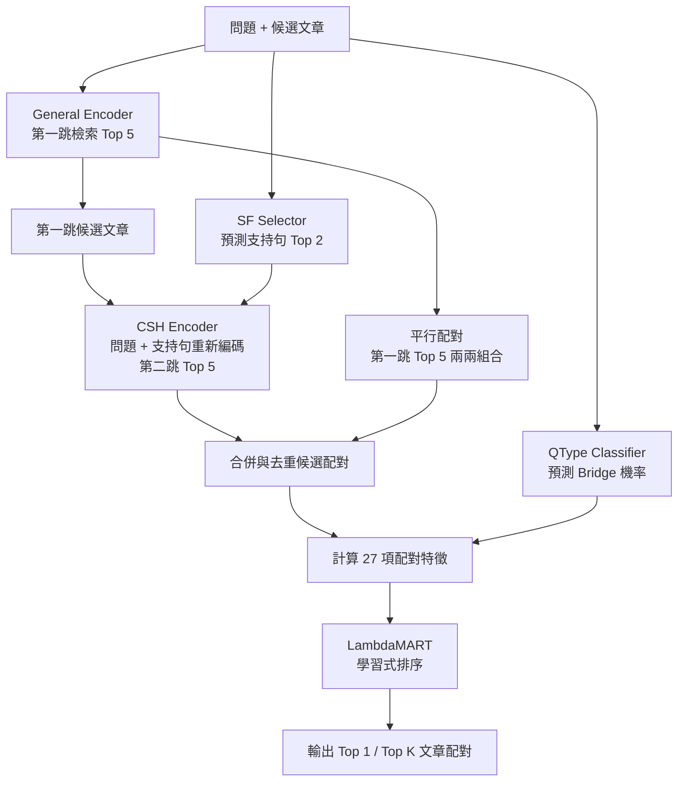

# HotpotQA — Project Architecture

本專案針對 **HotpotQA Distractor 多跳檢索**，從每題提供的 2–10 篇候選文章中，找出回答問題所需的兩篇支持文章。

- **研究歷程與實驗成果**：[HotpotQA_Research_Report.md](HotpotQA_Research_Report.md)
- **本文件**：系統架構、模組職責與程式碼位置。

## 01｜系統架構

| 模組 | 功能 |
|:--|:--|
| **General Encoder** | 根據問題找出第一跳候選文章 |
| **SF Selector** | 預測文章中最相關的兩句支持句 |
| **CSH Encoder** | 結合問題與第一篇文章的支持句，尋找第二篇文章 |
| **QType Classifier** | 預測 Bridge 題型機率，提供排序特徵，不直接分流 |
| **Candidate Generator** | 整合兩跳檢索與平行配對，產生無序文章配對 |
| **LambdaMART** | 根據 27 項特徵重新排序候選配對 |

## 02｜專案目錄與功能位置

| 功能 | 主要位置 |
|:--|:--|
| 資料讀取、切分與文章處理 | `src/rag_hotpotqa/data/` |
| 基礎檢索與向量編碼 | `src/rag_hotpotqa/retrieval/` |
| General Encoder 訓練 | `scripts/train_retriever.py` |
| SF Selector 訓練 | `scripts/train_sf_selector_cf.py` |
| CSH Encoder 訓練 | `scripts/train_second_hop.py` |
| QType 分類器訓練 | `scripts/train_qtype_classifier.py` |
| 候選文章配對生成 | `scripts/final_eval/gen_candidates.py` |
| LambdaMART 訓練 | `scripts/train_path_reranker.py` |
| 公開評估模型設定與完整性清單 | `configs/models.json`、`configs/release_manifest.json` |
| 歷史實驗凍結紀錄 | `configs/final_frozen.yaml` |
| 評估執行入口 | `scripts/run_eval.py` |
| 最終評估相關程式 | `scripts/final_eval/` |
| 正式評估結果 | `results/formal/` |
| 參考與凍結結果 | `results/reference/`、`results/freeze/` |
| 模型與執行產物（本機） | `models/`、`outputs/` |
| 模型 ZIP 安裝來源（本機） | `release_assets/` |

## 03｜閱讀與使用入口

- **想了解研究動機、實驗與成果**：閱讀 `HotpotQA_Research_Report.md`。
- **想理解模型如何訓練**：查看 `scripts/train_*.py` 與 `src/rag_hotpotqa/training/`。
- **想理解候選配對生成與最終評估流程**：查看 `scripts/final_eval/`。
- **想了解評估執行方式**：查看 `scripts/run_eval.py` 與 `README.md`。
- **想查看正式評估結果**：查看 `results/formal/`。
- **想查看參考與凍結結果**：查看 `results/reference/` 與 `results/freeze/`。
- **想了解模型安裝與驗證方式**：閱讀 `README.md`。

> 本專案完成的是 HotpotQA Distractor 模式下的文章配對檢索系統，不包含 LLM 答案生成或 FullWiki 全語料搜尋。
>
> 模型權重與執行產物不直接納入 Git repository。模型 ZIP 預計透過獨立發布管道提供；目前尚無公開下載網址，因此僅取得原始碼並不代表能直接重現完整評估結果。