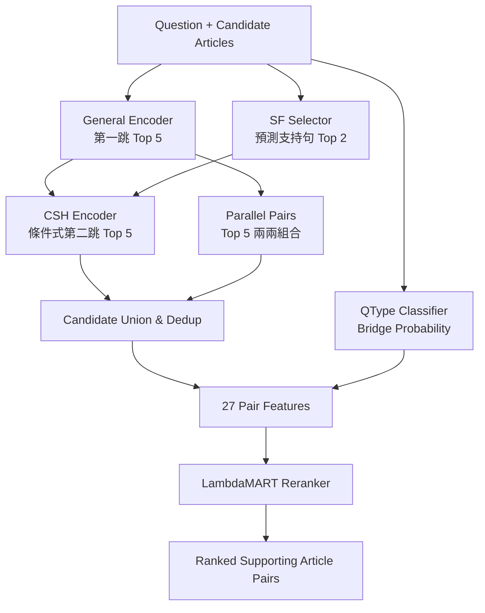

# HotpotQA Multi-hop Retrieval — Research Repository v0.1.0

本專案研究 **HotpotQA Distractor 多跳文章檢索**，目標是從每題提供的 2–10 篇候選文章中，找出回答問題所需的兩篇 Supporting Articles。

系統結合 Dense Retrieval、Supporting Sentence Selection、Conditional Second-Hop Retrieval 與 Learning-to-Rank。歷史正式評估在 Official Dev Distractor 達到 **Pair Recall@1 = 6,614 / 7,405 = 89.318%**；這不是 Answer EM/F1，也不包含 LLM 答案生成。

本目錄是獨立的 **Research Repository v0.1.0 發布來源**。以下路徑與指令均以本目錄為根，不依賴上層研究工作區。發布版提供固定資料準備、模型安裝、完整性檢查、單元測試及評估入口；歷史分數不代表此發布版已在全新環境完成端到端重現。

## 01｜系統架構



General Encoder 以正規化 embedding 相似度取得第一跳 Top 5；兩折 SF Selector 的預測分數平均後，為各文章選取 Top 2 支持句，組成 `Q + 預測支持句`，交由 CSH 搜尋第二跳 Top 5（排除第一跳本身）。若無可用支持句，使用該文章 body。另一支線取第一跳 Top 5 的所有兩兩配對，兩支線合併並去重為無序文章對。

每對文章抽取 27 個特徵，包括檢索分數、排名、BM25、句子分數、長度、標題關聯與 QType 的 Bridge 機率，再由 `R5_full` LambdaMART 排序。QType 是特徵，並非硬式路由。候選生成不使用 gold 支持句或 gold 配對；**document encoding 使用 title + body，第二跳 query 使用預測句／body，R5_full 另有標題特徵**，不能將整個系統描述為 body-only。實作見 [候選生成](scripts/final_eval/gen_candidates.py)、[即時計算 SF/QType](scripts/final_eval/live_inputs.py) 與 [排序入口](scripts/rank_public.py)。

## 02｜專案目錄

以下是發布版的主要位置；`models/`、原始資料、cache 與執行輸出由操作指令建立，不隨原始碼提供。

```text
RAG_HotpotQA_Github/
├── run.py                       # 公開 CLI，轉呼叫 scripts/
├── configs/                     # 檢索、模型與 release manifests
├── data/manifests/              # 固定來源、切分 ID 與 data lock
├── src/rag_hotpotqa/            # data、retrieval、training、ranking、evaluation、release、utils
├── scripts/final_eval/          # Baselines、SF/QType、候選生成
├── tests/                       # 單元測試（包含安全解壓與樹模型推論測試）
├── results/formal/              # 歷史正式評估報告
├── results/reference/           # 封存逐題 JSONL.gz 與 summary
├── results/freeze/              # 歷史 Freeze 證據，不是發布版執行 gate
├── release_assets/              # legal/（各模型授權文件）與 SHA256SUMS 進入 Git；六個 ZIP 被 .gitignore 排除，須另行提供
├── tools/maintainer/            # 資產封裝與 manifest 維護工具
├── pyproject.toml               # 套件 metadata、Python 範圍與 pytest 設定
├── requirements-lock.txt        # 固定 Python 套件版本
└── environment.yml              # Python 3.11 Conda 環境與主要依賴
```

## 03｜功能導覽

| 想了解的功能 | 查看位置 |
|---|---|
| 資料來源與切分 | `src/rag_hotpotqa/data/` |
| BM25 / Dense Retrieval | `src/rag_hotpotqa/retrieval/` |
| General Encoder | `scripts/train_retriever.py` |
| Supporting Sentence Selector | `scripts/train_sf_selector_cf.py` |
| Conditional Second-Hop | `scripts/train_second_hop.py` |
| QType Classifier | `scripts/train_qtype_classifier.py` |
| Candidate Generation | `scripts/final_eval/gen_candidates.py` |
| LambdaMART Ranking | `scripts/train_path_reranker.py` |
| 公開評估與逐題比較 | [run_eval.py](scripts/run_eval.py)、[compare_results.py](scripts/compare_results.py) |
| 模型安裝與完整性 | [fetch_models.py](scripts/fetch_models.py)、[integrity.py](src/rag_hotpotqa/release/integrity.py) |
| 發布版模型設定 | [models.json](configs/models.json)、[base_model.json](configs/base_model.json) |

## 04｜研究成果與文件

| 文件 | 內容 |
|---|---|
| [HotpotQA_Research_Report.md](HotpotQA_Research_Report.md) | 研究動機、實驗演進、方法比較與最終成果 |
| [PROJECT_ARCHITECTURE.md](PROJECT_ARCHITECTURE.md) | 發布版程式職責與資料流 |
| [正式結果](results/formal/README.md) | V-report 8,000、B/C 15,612、Official Dev 7,405 題 |

## 05｜安裝與環境（Python 3.11）

先進入本發布目錄，再建立獨立環境：

```sh
conda env create -f environment.yml
conda activate RAG-HotpotQA
python -m pip install --extra-index-url https://download.pytorch.org/whl/cpu -r requirements-lock.txt
python run.py --help
```

- `environment.yml` 建立 Python 3.11 與主要依賴；`requirements-lock.txt` 固定更完整的套件版本，包含 CPU 版 `torch==2.5.1+cpu`，不是附有 wheel hashes 的跨平台鎖檔。
- `pyproject.toml` 指定 Python `>=3.11,<3.12`、套件與 pytest 設定，**沒有宣告 runtime dependencies**；單獨 `pip install -e .` 不足以完成安裝。上述入口直接使用本地 `src/`，不要求 editable install。
- 原環境的 CPU 依賴版本不能視為所有 OS／架構均可安裝的保證；全新 Windows/Linux/macOS 安裝，尤其 macOS 的 `+cpu` wheel 相容性，尚未在本次文件修訂中驗證。

預設根目錄由程式位置決定，無須 `.env` 或 Token。需要本機設定時，可自行將 [.env.example](.env.example) 複製為 `.env`，不要提交機密。公開資料／基礎模型下載明確使用 `token=False`。標準重現請保持預設 `data/`、`outputs/`、`.cache/huggingface/`，並避免繼承上層研究環境的 `PROJECT_ROOT`、`DATA_ROOT`、`HF_HOME` 或 `RAG_HOTPOTQA_MODELS_MANIFEST`；部分公開腳本固定以發布根目錄解析路徑，不能假定任意外部資料路徑都受支援。CPU 對照可在本機設定 `DEVICE=cpu`。

`ALLOW_REMOTE_MODEL_DOWNLOAD=false` 是推論預設；明確的 `data`／`models` 安裝命令可下載資產。線上準備前不要設定 `HF_HUB_OFFLINE=1` 或 `TRANSFORMERS_OFFLINE=1`；正式評估的子程序會自行啟用離線模式。`ORIGINAL_DEV_JSON` 不是公開 `data` 流程的必要輸入。

## 06｜資料與六個模型資產

### 固定資料準備

來源為 HotpotQA 的 Hugging Face `hotpotqa/hotpot_qa`、`distractor` 設定，固定 revision `1908d6afbbead072334abe2965f91bd2709910ab`。來源、三個 parquet 的 SHA256、canonical JSONL 與切分 ID 均記錄於 [release_data_lock.json](data/manifests/release_data_lock.json)。

```sh
python run.py data --source hf
```

需要網路與足夠磁碟空間。若已有完全相同的三個 parquet，可改用下列命令，將 `PATH_TO_PARQUET_DIR` 換成實際目錄；接受 `distractor/` 子目錄或直接放置檔案：

```sh
python run.py data --source local --parquet-dir PATH_TO_PARQUET_DIR
```

流程驗證原始檔 hash、建立 `data/raw/canonical/` 與 `data/splits/`，驗證固定切分、題型數量及 ID 不重疊，最後寫入 `outputs/data_check.json`。它不重新抽樣、不修改 manifests；既有檔案不符合 lock 時停止。此流程不需要另外下載官方 Dev JSON：Dev canonical 檔必須符合已鎖定的歷史官方版本 hash。ID 不重疊不等於文章／語義完全無曝光。

### 模型用途與安裝

六個 ZIP 的大小、SHA256、解壓後檔案清單與 hash 均以 [configs/models.json](configs/models.json) 為準：

| ZIP | 用途／安裝位置 |
|---|---|
| `hotpotqa-general-encoder-v1.zip` | 第一跳 General Encoder → `models/general_encoder/` |
| `hotpotqa-csh-v1.zip` | 條件式第二跳 Encoder → `models/csh/` |
| `hotpotqa-sf-selector-fold0-v1.zip` | SF Selector 第 0 折 → `models/sf_selector_fold0/` |
| `hotpotqa-sf-selector-fold1-v1.zip` | SF Selector 第 1 折 → `models/sf_selector_fold1/` |
| `hotpotqa-qtype-frozen-lr-v1.zip` | 凍結 embedding + LR 的 Bridge 機率 → `models/qtype_frozen_lr/` |
| `hotpotqa-r5-full-v1.zip` | 27 特徵的 LambdaMART 樹與 schema → `models/r5_full/` |

**目前不提供尚未確認存在的公開模型下載網址。** Git 只追蹤 `release_assets/legal/`（ZIP 內授權文件的相同副本）與 `release_assets/SHA256SUMS`；六個 ZIP 與 `release_assets/staging/` 被 `.gitignore` 排除，不會因上傳程式碼就公開。外部使用者須向維護者取得六個 ZIP，放入同一目錄（例如 `release_assets/`）後執行：

```sh
python run.py models --from-dir release_assets
```

若放在其他位置，以實際目錄取代 `release_assets`。安裝器先檢查 ZIP 大小與 SHA256，僅允許 manifest 所列安全相對路徑，再驗證每個解壓檔案的 SHA256；不是單純手動 unzip。Encoder／SF 使用 safetensors，QType／R5 使用不需 pickle 的資產。已存在的模型目錄會被驗證，不會無條件覆蓋。

此命令預設另從 Hugging Face 下載 `sentence-transformers/all-MiniLM-L6-v2`，固定 revision `1110a243fdf4706b3f48f1d95db1a4f5529b4d41`，供 Dense baseline 與 QType 等使用；它不包含在六個 ZIP 中，詳見 [base_model.json](configs/base_model.json)。完整離線安裝需另有該 revision 的 HF hub cache：

```sh
python run.py models --from-dir release_assets --base-model cache --base-model-cache PATH_TO_HF_HUB
```

`PATH_TO_HF_HUB` 必須包含 `models--sentence-transformers--all-MiniLM-L6-v2/` 與對應 snapshot。`--base-model skip` 只跳過基礎模型安裝，不代表完整評估已具備條件。基礎模型安裝至本專案 `.cache/huggingface/hub/` 並校驗；Windows 路徑過長可能需要較短的專案位置或開啟 long paths。

可在安裝前獨立列出 ZIP SHA256，與 `configs/models.json` 的 `asset_sha256` 逐一比較；本機資產另附 `release_assets/SHA256SUMS`：

```sh
python -c "import hashlib,pathlib; [print(hashlib.sha256(p.read_bytes()).hexdigest(), p.name) for p in sorted(pathlib.Path('release_assets').glob('*.zip'))]"
```

授權分三層，詳見 [THIRD_PARTY_LICENSES.md](THIRD_PARTY_LICENSES.md)：原始碼為 MIT（[LICENSE](LICENSE)）；六個模型 ZIP 另以 Apache-2.0 授權，每個 ZIP 內附 `LICENSE`、`NOTICE`、`MODIFICATIONS.md`、`DATA_SOURCES.md`、`PROVENANCE.json`（四個 MiniLM 衍生模型另附 `UPSTREAM_MODEL_CARD.md` 與 `MINILM_MIT_LICENSE.txt`）；HotpotQA 資料仍適用 CC BY-SA 4.0，ZIP 不含原始題目或文章內容。授權文件已備妥，但 ZIP 本身目前尚未公開發布。

## 07｜檢查、測試與評估

下列指令已對照 [run.py](run.py) 與實際 argparse 實作。**本次發布修訂已執行 `python run.py test` 與 `python run.py check --code-only`；沒有執行資料下載、模型推論、完整訓練或完整評估**。

```sh
python run.py check --code-only
python run.py test
```

前者只驗證 release manifest 所列程式／設定等檔案，顯示 `READY` 也不代表模型或資料齊備。後者執行 `pytest -q -p no:cacheprovider`；需先安裝依賴，不要求下載正式資料或模型，但測試會使用暫存檔，不是唯讀操作。

完成資料與六個模型及基礎模型準備後：

```sh
python run.py check
python run.py smoke
```

完整 `check` 不執行模型，只檢查 release manifest、模型檔案集合與 hashes、基礎模型及資料 lock。`smoke` 執行 Official Dev 第一個 128 題 shard（六個 baselines + R5_full / R0），輸出至 `outputs/runs/smoke_official_dev_shard0/`，再對照封存逐題結果。它不是訓練 smoke，也不代表 7,405 題已重現；同名目錄已存在會拒絕執行，沒有自動覆蓋／續跑。

完整評估與比較（會進行模型推論並寫入輸出，可能耗時數小時以上）：

```sh
python run.py evaluate --part official_dev_distractor --run-name official_dev_v010
python run.py compare --run official_dev_v010
```

不提供 `--part` 時預設 Official Dev。也支援下列資料部分與只跑六個 baselines 的入口；每次使用新的 run name：

```sh
python run.py evaluate --part v_report --run-name v_report_v010
python run.py evaluate --part bc_holdout --run-name bc_holdout_v010
python run.py baselines --part official_dev_distractor --run-name baselines_v010
```

`--part` 可重複指定；`--shards N` 僅跑前 N 個 128 題 shard，屬於部分評估。六個 baselines 為 BM25 local/train-global、Dense、Hybrid local/train-global、General Encoder。公開 runner 依序執行 baselines → SF/QType → candidates → R5_full/R0，每個 shard 使用獨立 cache、20 題 baseline prefill 與 8 threads，保存 logs、逐題結果、summary 與 preflight；預設離線推論，缺少資產即停止。

`compare` 比較 `pr1`、`cand`、`gold_rank`、`top1_pair`、`top5`（包含保存的浮點分數）及題型，輸出 `comparison.json`。有 reference 的欄位要求完全相等，無浮點容差；完整資料部分另比較 PR@1 聚合物件，部分 shard 不比較全體統計。應逐方法查看 `EXACT / DIFFERENT / NO_REFERENCE`，不能只看退出碼：**歷史 Official Dev 沒有 R0 reference**，公開 runner 新算的 R0 會列為 `NO_REFERENCE`，不表示它已重現歷史正式結果。

### 重新訓練（`python run.py train`）

依 [configs/training_full.yaml](configs/training_full.yaml) 的相依順序，從基礎模型與固定切分重新訓練 Full method 的全部模型：general_encoder → qtype → qtype_artifact → sf_fold0／sf_fold1 → csh_mine → csh → candidates（V-select、Training）→ r5 → export → load_check。**不需要也不使用**六個發布 ZIP。

```sh
python run.py data --source hf
python run.py models --base-model-only --base-model hf
python run.py train --profile smoke --dry-run      # 只列出解析後的指令，不執行
python run.py train --profile smoke                # 小子集：資料 → 訓練 → checkpoint → 選模 → 匯出 → 載入檢查
python run.py train --profile full                 # 正式設定（CPU，需時很長）
python run.py evaluate --models-manifest outputs/trained_models/full/models.json --part official_dev_distractor --shards 1
```

- 前置條件：完整資料 lock 與釘選的基礎模型必須通過驗證，否則在訓練前停止（exit 2）。
- 輸出：`outputs/trained_models/<profile>/models/` 與 `models.json`（與 `configs/models.json` 相同模型名稱與檔案集合），log 在 `logs/<step>.log`。可用 `--until STEP` 在指定步驟後停止；重跑同一指令會跳過已完成步驟並由 checkpoint 續跑。
- 匯出時，授權文件不是訓練產物：`LICENSE`、`NOTICE`、`DATA_SOURCES.md` 等取自 `release_assets/legal/<model>/` 並比對 `configs/models.json` 的 SHA256；`PROVENANCE.json` 與 `MODIFICATIONS.md` 改寫為重新訓練的來源紀錄（保留發布版原文與上游授權資訊）。
- 限制：重新訓練的權重**不是**發布權重，不保證與歷史分數逐位相同；`full` 與 `smoke` 的端到端訓練在本次發布修訂中**皆未執行**，已驗證的是訓練計畫解析（`--dry-run`）與匯出邏輯的單元測試。

## 08｜正式結果、完整性與研究限制

封存 [Official Dev 報告](results/formal/official_dev_distractor_7405.md) 與 [逐題參考](results/reference/official_dev_distractor.per_question.jsonl.gz) 記錄 `R5_full` 正確 **6,614 / 7,405 = 89.318%**。Pair Recall@1 是首位無序文章對是否完整等於兩篇 gold supporting articles；每題記 0/1，候選中缺少 gold pair 也記 0。Baseline 以排名前兩篇組成一個配對。這不是單篇 Recall@1、Candidate Recall 或 Answer EM/F1。

發布版執行 gate 是三層檢查，不是原研究工作區的 285-file Freeze：

1. [release_manifest.json](configs/release_manifest.json)：驗證其列出的程式、設定及參考產物；文字檔 CRLF 正規化成 LF 後計算 SHA256，二進位使用原始 bytes。它不涵蓋整個目錄，也不是簽章／遠端不可竄改證明。
2. [models.json](configs/models.json) 與 [base_model.json](configs/base_model.json)：鎖定 ZIP、模型檔案集合／hash 與基礎模型 revision。ZIP 與權重使用原始 bytes 的 SHA256。
3. [release_data_lock.json](data/manifests/release_data_lock.json)：鎖定原始 parquet、canonical 資料及 split IDs。`run_eval.py` 全部通過才建立該次 run 的 `authorisation.json` 與 preflight 記錄。

[results/freeze/](results/freeze/) 是歷史證據；`configs/final_frozen.yaml` 仍有原工作區路徑，**不應作為公開執行入口或手動照該路徑補檔**。公開 runner 使用 release manifest 產生授權，不使用該歷史 YAML 的 manifest 路徑。檔案完整性不等於科學上的無資料洩漏證明。

目前可直接核對的是發布版 CLI／實作、資產與 hashes、封存結果；模型轉存後在全新環境的 smoke、完整逐題一致性與端到端重現仍須實際執行上述流程驗證，不能用歷史報告中的 PASS 取代。主要限制：

- 只驗證題目提供候選文章的 **Distractor Retrieval**，不代表全 Wikipedia 或 open-domain retrieval 能力；不生成答案。
- V-select 用於開發／選模；B/C 曾用於早期 QType 評估，不能稱為完全未曝光盲測。資料 ID 分離不能排除跨題文章重複、語義重疊或預訓練曝光。
- Official Dev 的 R5 對單跳 baseline 差距是整體系統差距，不能歸因為相同候選下的純 reranker 增益。歷史 Official Dev 未跑 R0 或完整消融。
- Phase 9 FullWiki 已取消（Out of Scope）；FullWiki、MDR 對照與直接優於 MDR 的主張均未完成驗證。發布版亦不自動重跑歷史 20 組消融。
